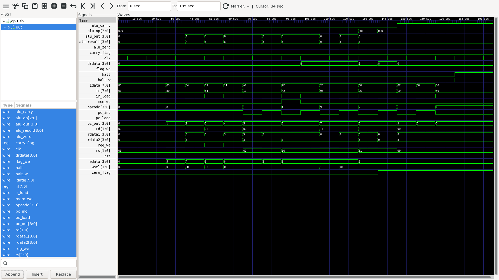
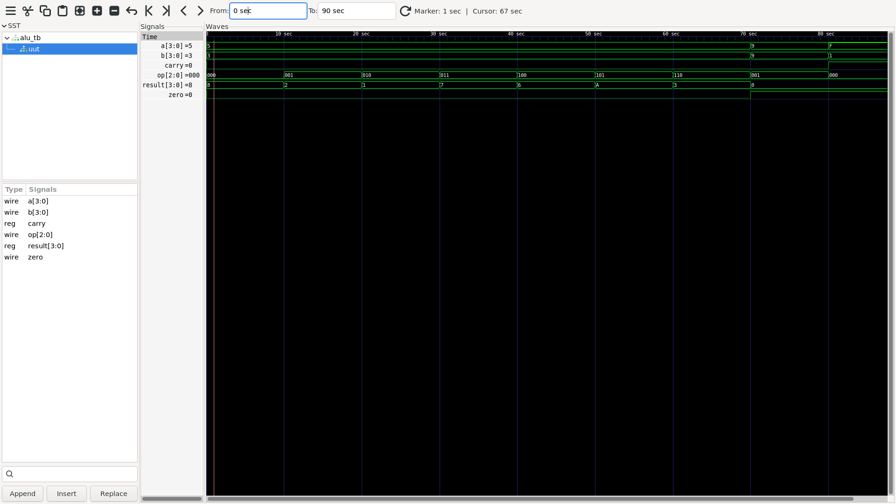
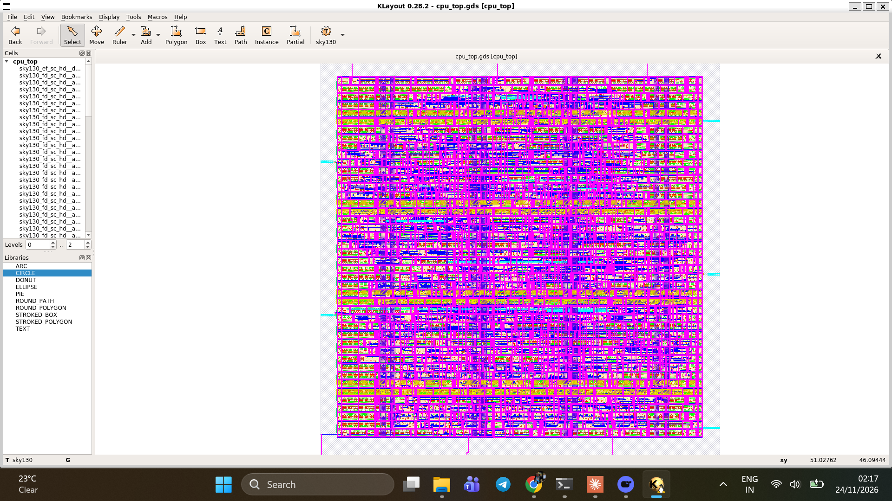

# 4-bit Processor: RTL Design to GDSII (Sky130, OpenLane)

A custom 4-bit processor with its own 8-bit instruction set, written in Verilog, simulated with Icarus Verilog and GTKWave, and taken through the complete RTL-to-GDSII flow with open-source tools (Yosys, OpenROAD, Magic, KLayout) on the SkyWater 130nm PDK.

## Architecture

- Data width: 4 bits, 4 registers (R0-R3)
- Modules: ALU, register file, program counter, memory (16 x 8-bit ROM + 16 x 4-bit RAM), control unit (FSM), cpu_top
- Control FSM: FETCH -> EXECUTE -> HALT
- Flags: zero, carry

## Instruction set (8-bit: opcode[7:4], rd[3:2], rs[1:0])

| Opcode | Instruction | Operation |
|---|---|---|
| 0000 | NOP | no operation |
| 0001 | ADD rd, rs | rd = rd + rs |
| 0010 | SUB rd, rs | rd = rd - rs |
| 0011 | AND rd, rs | rd = rd & rs |
| 0100 | OR rd, rs | rd = rd or rs |
| 0101 | XOR rd, rs | rd = rd ^ rs |
| 0110 | NOT rd | rd = ~rd |
| 0111 | MOV rd, rs | rd = rs |
| 1000 | LDI rd, imm | rd = next byte (immediate) |
| 1001 | LD rd, [rs] | rd = MEM[rs] |
| 1010 | ST rd, [rs] | MEM[rs] = rd |
| 1011 | JMP addr | PC = addr (next byte) |
| 1100 | JZ addr | jump if zero flag set |
| 1111 | HALT | stop |

## Simulation

Test program: LDI R0,5; LDI R1,3; ADD R0,R1; ST; LD; SUB R1,R1; JZ 12 (taken, skips LDI R3,15); HALT.

Result: R0=8, R1=0, R3=8, MEM[0]=8, PC=13, halt=1 -> CPU TEST PASSED

## RTL to GDSII (OpenLane 1.0.2, sky130_fd_sc_hd)

Flow: Yosys synthesis -> floorplan -> tap/decap -> PDN -> global placement -> resizer -> detailed placement -> CTS -> global routing -> detailed routing -> RC extraction -> multi-corner STA -> Magic/KLayout GDSII -> DRC, LVS, antenna checks.

| Metric | Value |
|---|---|
| Clock period | 20 ns (50 MHz) |
| Setup / hold violations | None (WNS = 0, TNS = 0) |
| DRC violations | 0 |
| LVS | Clean |
| Antenna violations | 0 |
| Synthesized cells | 562 |
| Total cells (incl. tap/decap/fill) | 1912 |
| Die area | 0.0189 mm2 |
| Core area | 14,479 um2 (120.98 x 119.68 um) |
| Utilization | 42.4% |
| Total wire length | 13,789 um |
| Total power (typical corner) | 1.69 mW |

Minor max-fanout warnings were reported at the typical corner. No timing violations.

## How to run

Simulation:

    iverilog -o sim_cpu rtl/*.v tb/cpu_tb.v
    vvp sim_cpu
    gtkwave cpu.vcd

OpenLane (from the OpenLane folder, inside make mount):

    mkdir -p designs/cpu4/src
    cp rtl/*.v designs/cpu4/src/
    cp openlane/config.json designs/cpu4/
    ./flow.tcl -design cpu4 -tag run1 -overwrite

## Repository layout

- rtl/ : Verilog source
- tb/ : testbenches
- openlane/config.json : OpenLane configuration
- reports/ : metrics, manufacturability, power report, GDS
- docs/ : waveforms and layout images

## What I learned

- Designing a datapath plus FSM controller and verifying it module by module
- Making RTL synthesizable (hard-coded ROM instead of file loading)
- Reading floorplan, placement, CTS and routing results, and closing DRC/LVS/timing

## Tools

Icarus Verilog, GTKWave, Yosys, OpenROAD, Magic, KLayout, OpenLane, SkyWater sky130 PDK.
